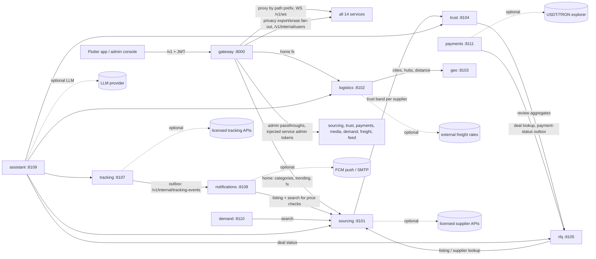

# Architecture — Factory Finder

_Last refreshed 2026-10-15 against the code (`services/*/src`, `docker-compose.yml`). Decision history: `docs/decisions/README.md`._

## 1. Big picture

The Flutter app (`apps/mobile`) and the admin console (`apps/admin`, optional, served by the gateway at `/admin`) talk **only** to the gateway (`/v1/*`, JWT). The gateway authenticates, applies policy, and routes by path prefix to 14 backend services. Services call each other over HTTP only where shown in the graph in §2; each service owns its own database (no shared tables). All service-to-service and gateway-to-service calls use the contracts in `contracts/`.

## 2. Services (15) and ports

| Service | Port | Purpose | Store |
|---|---|---|---|
| gateway | 8000 | Auth, users, routing, policy, admin passthroughs, supplier claims, account export/deletion, WS proxy, `/v1/home` aggregate | SQL (users, refresh tokens, claims + claim audit, email/reset tokens, account events, deletion jobs) |
| sourcing | 8101 | Search across adapters; native supplier listings (`/v1/my`), moderation, price history, similar/recommendations, privacy-safe analytics | SQL |
| logistics | 8102 | Landed-cost engine, FX, carriers, HS finder, import-compliance advisor, optional external freight-rate adapter | stateless (data files) |
| geo | 8103 | Countries, cities, sea/air/land hubs, nearest hub, distance | data files |
| trust | 8104 | Explainable supplier trust score 0-100 + verification documents pipeline (reviewer audit) | SQL |
| rfq | 8105 | Buyer requests (public / invite-only), offers, deals, commission, reviews; receives payment status from payments | SQL |
| messaging | 8106 | Conversations, messages, attachments, blocks, abuse filter (REST + WebSocket) | SQL (+ optional Redis) |
| tracking | 8107 | Shipments by container / B/L / AWB / vessel IMO, normalized timeline, outbox relay | SQL |
| notifications | 8108 | Watchlists, price-drop alerts, inbox, prefs, devices, digest email, push/email delivery queue | SQL |
| assistant | 8109 | Arabic/English natural-language assistant: parse -> tool calls -> one answer | stateless (+ optional Redis for quota/rate limit) |
| demand | 8110 | Phase-5 demand matching: signals -> draft public replies -> human approval; OFF by default (admin only) | SQL |
| payments | 8111 | Invoices (mock / USDT-TRON provider), signed webhooks, ledger, outbox to rfq, commission | SQL |
| media | 8112 | Image upload/processing; public and private (signed URL) files | SQL metadata + local/S3 files |
| feed | 8113 | Supplier posts, follow, home/trending feed, likes, comments, reports + moderation, anti-spam | SQL |
| freight | 8114 | Freight-forwarder marketplace: applications (admin-approved), quote requests, quotes, ranking, award, ratings, reports | SQL |

### Service graph

Solid arrows are runtime HTTP calls found in each service's `clients/` / config (verified in code). The gateway-to-service edges are shown once as a fan-out (every service is in `DEFAULT_UPSTREAMS`).



Services with no outbound service calls: geo, messaging, media, feed, freight (they are only called by the gateway). Dotted edges are adapters that are off by default.

## 3. Gateway responsibilities

Code: `services/gateway/src/ff_gateway` (`api/`, `domain/`).

- **Auth and sessions**: register/login/refresh/logout/logout-all, email verification, password forgot/reset, password change. HS256 JWT access tokens (15 min), refresh tokens server-tracked (hashed jti + family, single use, reuse detection). Key rotation via `jwt_secret_previous`.
- **Routing** (`domain/routing.py`): path-prefix table to upstreams; public-GET allowlist; internal-only paths (`/v1/alerts/evaluate`, `/v1/alerts/digest`, `/v1/media/admin`, and all `/v1/internal/*`) are never routable from outside.
- **Identity forwarding**: `X-User-Id`, `X-Internal-Token`, `X-Request-Id`; `X-Supplier-Id` only for accounts whose supplier claim is `verified` (read from the gateway DB, never from the client).
- **Supplier claims + audit**: `PATCH /v1/me {supplier_id}` records a pending claim (first claimer wins); admin approve / reject / revoke (`/v1/admin/supplier-claims/*`) and `GET .../audit`. Verified claim gates `/v1/my/*` and `/v1/trust/verification/*` writes; optional `FF_GATEWAY_REQUIRE_EMAIL_VERIFIED` also gates payments writes and claims.
- **Admin surface** (`X-Admin-Token`; 404 when `FF_GATEWAY_ADMIN_TOKEN` is unset): claims, account-deletion jobs, overview, and allow-listed passthroughs to sourcing moderation, trust verification review, payments outbox, media private files, demand, freight and feed moderation. The gateway injects each service's admin token and a fixed `admin` actor; client-supplied identity is dropped. Audit trails: gateway `AccountEvent` rows and claim audit, trust reviewer audit, demand audit log.
- **Aggregation**: `GET /v1/home` (sourcing categories + trending, logistics FX); a failing section becomes `null` plus a warning.
- **Account privacy**: `GET /v1/me/export` and `DELETE /v1/me` fan out to `/v1/internal/users/{id}/export|data` on services holding user data; durable `DeletionJob` rows retried by a background worker.
- **WebSocket**: `POST /v1/ws-ticket` (short-lived, single-use) then proxied `WS /v1/ws/conversations/{id}` to messaging, with per-user caps and a max session length.
- **Protection**: per-IP and per-user rate limits (memory or Redis), login-failure limiter, per-upstream circuit breaker, body-size caps and read timeouts, trusted-proxy-aware client IP, CORS off by default.

## 4. Data flows

1. **Search**: app -> gateway (`GET /v1/search`, public) -> sourcing. Sourcing fans out to enabled adapters (`mock`, `native`, licensed ones), merges, de-duplicates, ranks, and attaches a trust band by calling trust (`GET /v1/trust/suppliers/{id}`, 0.8 s timeout, failure degrades to `unknown`). Per-source status is returned in `sources[]`. Price observations feed history/similar/recommendations.
2. **Landed cost**: app -> gateway (`POST /v1/quotes/landed-cost`, public) -> logistics. Logistics asks geo for cities, hubs and distances, builds per-mode options (§12), applies the duty/VAT table, converts with FX (`FF_LOGISTICS_FX_PROVIDER`: `mock` default, `ecb` via Frankfurter with fallback to mock on errors), and optionally blends an external freight-rate adapter. Output is ranges with estimate flags and warnings.
3. **Tracking**: app -> gateway -> tracking (`POST /v1/shipments`, refresh, validate). Provider adapters are `mock` by default, `http` (licensed) opt-in. An optional refresh job re-polls active shipments. Events are written to `tracking_outbox` and pushed by the relay to notifications `POST /v1/internal/tracking-events`, which creates inbox alerts.
4. **RFQ -> deal -> payment**: buyer posts a request (gateway -> rfq); suppliers offer; buyer accepts, which creates a Deal with commission. Payments creates invoices for a deal (it reads the deal from rfq), a provider (mock / USDT-TRON) settles them through signed webhooks, and every `paid` / `refunded` move writes an outbox row in the same transaction, delivered idempotently to rfq `POST /v1/internal/deals/{id}/payment-status` (backoff, dead-letter, admin requeue). Completed deals unlock verified reviews in rfq, which trust reads as a signal.
5. **Freight marketplace**: forwarders apply (admin approves in freight); buyers post shipment quote requests; approved forwarders quote; freight ranks quotes with explainable scoring; buyer awards; both sides rate after a delay; reports lead to hide/restore moderation. This is separate from logistics' optional external freight-rate adapter, which only feeds landed-cost estimates.
6. **Feed**: suppliers post (images via media); anyone browses trending (anonymous allowed) or the personalised home feed; follow, like, comment, report. Deterministic anti-spam and a report threshold auto-hide content; admin moderates through the gateway.
7. **Assistant**: app -> gateway -> assistant (`POST /v1/assistant/query`). A rule-based parser is the source of truth; an optional LLM only refines low-confidence parses (and optionally rewrites tone, with numbers verified). Intents call sourcing, logistics (landed cost, HS), trust, tracking (shipment status) and rfq (deal status). Prompt-injection text short-circuits to a help answer. Per-user quota and rate limit.
8. **Notifications / watchlist**: users watch listings or searches; the scheduler (off by default) or `POST /v1/alerts/evaluate` (internal) re-checks prices through sourcing and emits alerts; delivery queue sends push/email only if a provider is enabled.
9. **Demand matching (Phase 5)**: admin-fed public buy signals -> sourcing search -> draft public replies -> human approval -> optional publisher. Global kill switch, daily cap, no automated private messages.

## 5. Trust score inputs

Engine: `services/trust/src/ff_trust/domain/scoring.py`. Score = clamp(baseline 40 + sum(round(weight x f)), 0, 100) with f in [-1, 1] (saturating curves), then hard caps; the result lists every factor, a `confidence` 0-100 and `data_gaps`. Missing data is never negative.

Inputs (`SupplierSignals`):
- Marketplace signals: years in business, verified flag, third-party audit, transactions, response rate, rating average and review count (Bayesian shrinkage), dispute rate, certifications, domain age, physical address, contact consistency, price vs market, country risk.
- v2 signals: business-licence status, certification records (with expiry), storefront age, repeat-buyer rate, response time, recent (90 d) disputes, refund rate, deals completed / cancelled, confirmed (accepted) reports.
- Platform signals: rfq verified-purchase review summary (`platform_reviews`, fetched from rfq with a 60 s cache) and reviewer-approved verification documents (reward-only, decaying toward expiry).
- Hard-fail: `sanctions_hit` and platform `blocked` force red.
Score snapshots are stored for history. Trust score is a guide, not a guarantee.

## 6. Adapters and kill switches

Every external source or provider is an adapter with a deterministic mock; tests never touch the network. Real adapters are off by default, read public pages only where lawful (CLAUDE.md rule 6), and can be disabled by config.

| Area | Adapters | Default | Switch |
|---|---|---|---|
| Sourcing | `mock`, `native`; `alibaba`, `alibaba_openapi`, `aliexpress`, `made_in_china`, `source_1688`, generic licensed REST (mapping driven) | `FF_SOURCING_ENABLED_SOURCES=mock,native` | `FF_SOURCING_KILL_SWITCH=1` (all real), per-provider `*_DISABLED` |
| Logistics FX | `mock`, `ecb` (Frankfurter, no key) | `mock` | `FF_LOGISTICS_FX_PROVIDER` |
| Logistics freight rates | optional HTTP freight provider | off (`FF_LOGISTICS_FREIGHT_URL` empty) | `FF_LOGISTICS_KILL_SWITCH`, cooldown after errors |
| Tracking | `mock`, `http` (container, AWB, vessel; UNVERIFIED wire shapes) | `FF_TRACKING_PROVIDER=mock` | `FF_TRACKING_KILL_SWITCH`, per-kind `*_DISABLED` |
| Assistant LLM | `mock`, `anthropic` (Messages shape, configurable base URL) | `off` | `FF_ASSISTANT_LLM=off` |
| Payments | `mock`, `usdt_tron`, `off` | `mock` | `FF_PAYMENTS_PROVIDER=off` |
| Notifications | push (`off`/`mock`/`fcm`), email (`off`/`mock`/smtp) | off | `FF_NOTIFY_PUSH`, `FF_NOTIFY_EMAIL` |
| Gateway mail | `off`, `mock`, `smtp` | off | `FF_GATEWAY_MAIL_BACKEND` |
| Media storage | `local`, `s3` (UNVERIFIED) | `local` | `FF_MEDIA_STORAGE_BACKEND` |
| Demand | publisher mock / real | off | `FF_DEMAND_ENABLED=false` (approve/publish answer 403), `FF_DEMAND_PUBLISHER_ENABLED=false` |
| Messaging | abuse filter | on | `FF_MESSAGING_ABUSE_FILTER_ENABLED` |

## 7. Security model (summary)

- Only the gateway is public. Services trust `X-User-Id` only with a valid `X-Internal-Token` (when `FF_INTERNAL_TOKEN` is set; required in production). `/v1/internal/*` routes have no gateway route.
- Service admin routes need the service admin token, which only the gateway holds; the gateway's own admin routes need `X-Admin-Token` and 404 when it is unset. Admin passthroughs are allow-listed by method and path regex, with a query allow-list.
- Secrets come from environment variables only (repo is public); `.env.example` has empty values. Never log keys or full PII.
- Supplier identity: a user acts as a supplier only after an admin-verified claim; the gateway derives `X-Supplier-Id` from its DB.
- Private media (`kind=verification`, always private) is served to the owner or via short-lived signed URLs; admins read through the gateway. Trust refuses a file id already attached by another supplier.
- Abuse controls: gateway rate limits and breaker, per-service caps (offers per supplier, shipments per user, feed and freight rate events), anti-spam, report thresholds, prompt-injection guard, deletion/export rate limit, retention sweeps for old records.
- Money: `Decimal` / decimal strings everywhere; payments webhooks are HMAC-signed; deal totals use a wide Decimal context.
- Privacy: export and erase fan-out to every service that holds user data; hosting images and logs avoid per-viewer rows (analytics are daily aggregates).
- Container: internal + egress networks, `--no-server-header`, `--no-proxy-headers` (see `docs/DEPLOY.md`).

## 8. Data stores

- One SQLAlchemy 2 (async) database per stateful service via `FF_<SVC>_DATABASE_URL`; PostgreSQL in production (asyncpg), SQLite file default in dev, in-memory in tests. Stateful: gateway, sourcing, trust, rfq, messaging, tracking, notifications, demand, payments, media, feed, freight. Stateless: logistics, geo, assistant.
- Migrations: Alembic for rfq, messaging, tracking, notifications, demand; the others create tables on startup (`FF_<SVC>_DB_AUTO_CREATE`). See `docs/DB.md`.
- Redis (optional, memory fallback): gateway rate limits, WS tickets and socket counters; messaging fan-out; assistant quota and rate limit.
- Files: media service local disk or S3-compatible bucket.
- Bundled data files: geo hubs and sea-lane graph, logistics duty/VAT, HS and compliance tables, sourcing mock catalog.

## 9. Background jobs

There is no separate worker process; jobs run inside services and are mostly opt-in.

| Job | Service | Default | Notes |
|---|---|---|---|
| Account-deletion worker | gateway | on (60 s) | retries per-service erase jobs, grace-period sweep; `FF_GATEWAY_DELETION_WORKER_INTERVAL_SECONDS=0` disables |
| Tracking refresh job | tracking | off (`FF_TRACKING_REFRESH_JOB_ENABLED`) | re-polls active shipments (6 h min interval) |
| Tracking -> notifications relay | tracking | off (`FF_TRACKING_NOTIFY_RELAY=on` + base URL) | drains `tracking_outbox` with backoff |
| Alert scheduler | notifications | off (`FF_NOTIFICATIONS_SCHEDULER_ENABLED`) | otherwise `POST /v1/alerts/evaluate` / `/digest` from a cron |
| Payments sweep | payments | on demand (`POST /v1/payments/sweep`, admin) | polls provider for open invoices, expires them, drains outbox, retention |
| Freight sweep | freight | on demand (admin `POST /sweep`) | housekeeping sweep |
| Media orphan sweep | media | on demand | dry run by default |
| Demand poll | demand | on demand (admin `POST /v1/admin/demand/signals/poll`) | retention runs inside |

Run these from an external scheduler (cron, k8s CronJob) in production.

## 10. Conventions (all Python services)

**Layout**
```
services/<name>/
  pyproject.toml                # deps + [tool.pytest.ini_options] pythonpath=["src"]
  README.md
  src/ff_<name>/
    __init__.py
    main.py                     # app = create_app()
    config.py                   # pydantic-settings, env prefix FF_<NAME>_
    api/                        # FastAPI routers (thin)
    domain/                     # pure business logic (no I/O) — most tests live here
    adapters/                   # external sources/providers: base.py + mock.py + <real>.py
    clients/                    # HTTP clients to OTHER services: Protocol + http + mock
    data/                       # bundled static data (json/csv) when needed
  tests/
```
- Python ≥ 3.12. Dev uses the shared virtualenv at repo root: `.venv/bin/python -m pytest services/<name>`. Do not create other venvs. If you truly need a new package, add it to your `pyproject.toml` and install it with `.venv/bin/pip install <pkg>` (only that package).
- Every service: `GET /health` → `{"status":"ok","service":"<name>","version":"0.1.0"}`; all business routes under `/v1`.
- Error body (every non-2xx): `{"error":{"code":"snake_case_code","message":"human text","details":{}}}`.
- JSON field names are **snake_case**. IDs are strings (`"lst_..."`, `"sup_..."`, `"req_..."` — prefix + ULID/uuid4 hex).
- Money in JSON: `{"amount":"1234.50","currency":"USD"}` — amount is a **decimal string**. Use `Decimal` in Python, never float, for money.
- Countries: ISO-3166 alpha-2 (`CN`, `US`, `DE`, `IQ`). Currencies: ISO-4217. Ports: UN/LOCODE where it exists (`CNSHA`, `IQUQR`).
- Timestamps: ISO-8601 UTC (`2026-10-08T19:00:00Z`).
- Internal auth: the gateway forwards `X-User-Id` and `X-Internal-Token`. Services check the token only when `FF_INTERNAL_TOKEN` is set (unset in dev/tests).
- Persistence: SQLAlchemy 2 (async) with `FF_<NAME>_DATABASE_URL`; default `sqlite+aiosqlite:///./<name>.db`; tests use in-memory SQLite. Tables are created on startup in dev (Alembic later).
- Logging: structured, never log secrets or full user PII.

## 11. Public API (core routes; served by each service, exposed by the gateway under the same paths)

This is the original core surface. The complete, current list per service (native listings `/v1/my/*`, price history, recommendations, HS finder, compliance, reviews, invoices, media, feed, freight, ...) is `contracts/openapi/<service>.yaml`.

**sourcing** — `GET /v1/search` (q, kind=`product|raw_material|production_line`, condition=`new|used|any`, origin_country, category, min_price, max_price, moq_max, verified_only, page, page_size) → `{items:[Listing], total, page, page_size, sources:[{source,status,count}]}` · `GET /v1/listings/{id}` → ListingDetail · `GET /v1/suppliers/{id}` → Supplier · `GET /v1/categories` · `GET /v1/sources`

**logistics** — `POST /v1/quotes/landed-cost` (LandedCostRequest) → LandedCostQuote · `GET /v1/fx/rates?base=USD` · `POST /v1/fx/convert` · `GET /v1/carriers?origin_country=&destination_country=&mode=`

**geo** — `GET /v1/countries` · `GET /v1/cities?country=&q=` · `GET /v1/hubs?country=&type=sea|air|land` · `GET /v1/hubs/nearest?lat=&lon=&type=&limit=` · `GET /v1/distance?from_lat=&from_lon=&to_lat=&to_lon=&mode=road|sea|air`

**trust** — `GET /v1/trust/suppliers/{supplier_id}` → TrustScore · `POST /v1/trust/evaluate` (SupplierSignals) → TrustScore

**rfq** — `POST /v1/requests` · `GET /v1/requests` (mine, status, kind, page) · `GET /v1/requests/{id}` · `POST /v1/requests/{id}/offers` · `GET /v1/requests/{id}/offers` · `POST /v1/offers/{id}/accept` → Deal · `GET /v1/deals/{id}`

**messaging** — `GET /v1/conversations` · `POST /v1/conversations` · `GET /v1/conversations/{id}/messages` · `POST /v1/conversations/{id}/messages` · `POST /v1/conversations/{id}/read` · WS `/v1/ws/conversations/{id}`

**tracking** — `POST /v1/shipments` (reference, reference_type=`container|bl|awb|vessel_imo`, carrier?) · `GET /v1/shipments` · `GET /v1/shipments/{id}` · `POST /v1/shipments/{id}/refresh` · `GET /v1/validate/{reference_type}/{reference}`

**notifications** — `POST /v1/watchlist` · `GET /v1/watchlist` · `DELETE /v1/watchlist/{id}` · `GET /v1/alerts` · `POST /v1/alerts/evaluate` (internal) · `POST /v1/devices`

**assistant** — `POST /v1/assistant/query` `{text, locale, destination?}` → `{intent, parsed_query, answer_text, listings, quote?, trust?}`

**gateway (own)** — `POST /v1/auth/register` · `POST /v1/auth/login` · `POST /v1/auth/refresh` · `GET /v1/me` · `PATCH /v1/me` · `GET /v1/home` (aggregated feed)

Each service writes its OpenAPI in `contracts/openapi/<service>.yaml` and reuses `contracts/schemas/common.schema.json` (`$ref`).

## 12. The landed-cost engine (logistics) — the core differentiator

Input: listing or manual goods (value, quantity, weight kg, volume m³, HS code optional, category), origin (country + city or lat/lon), destination (country + city), incoterm the supplier quoted (EXW / FOB / CIF …), preferred modes.

Steps per transport option (`sea_lcl`, `sea_fcl_20`, `sea_fcl_40`, `sea_fcl_40hc`, `air`, `rail`, `road`):
1. **Origin hub selection** — ask geo for nearest suitable hubs (sea port / airport / rail or land crossing) to the factory; consolidation hubs (e.g. Yiwu, Guangzhou) are considered for LCL.
2. **Origin inland** — road distance × rate per km per vehicle class (by country table) + handling; skipped if incoterm already covers it.
3. **Main leg** — rate provider adapter (mock rate tables per trade lane; real providers later) using chargeable weight (air: max(actual, volume×167 kg/m³); LCL: W/M with 1 m³ = 1000 kg; FCL: container fit by volume/weight).
4. **Destination hub** — best port/airport/border for the destination city (geo), including transshipment notes (e.g. Iraq: Umm Qasr by sea, or via Mersin + truck through Ibrahim Khalil, or Jebel Ali + truck).
5. **Duties & taxes** — estimate from a per-country table (default duty % by HS chapter + VAT/GST + fixed clearance fees). Always returned as an **estimate range** with the rule used.
6. **Destination inland** — road distance from hub to city × local rate.
7. **FX** — every line converted to the buyer's display currency with rate + timestamp.

Output: options sorted by total cost, each with `lines[]` (stage, description, amount, currency, source, estimate flag), `total` (MoneyRange), `transit_days` (min/max), `co2_kg` (optional), `recommended` flag and `warnings[]` (e.g. oversized for LCL, dangerous goods, sanctions/embargo flags for the lane).

## 13. Supplier sources (sourcing adapters)

See also §6 for the adapter and kill-switch inventory across all services.

`base.SourceAdapter` → `search(query) -> list[Listing]`, `get_listing(id)`, `get_supplier(id)`, `health()`.
Adapters: `mock` (rich deterministic catalog: products, raw materials, production lines new & used, origins CN/US/DE/IT/TR…), `alibaba` (official Open Platform API — disabled until keys exist), `made_in_china`, `aliexpress` (affiliate API), `source_1688`, `us_*`, `eu_*` stubs. Real adapters obey CLAUDE.md rule 6 and are off by default. Results from all enabled adapters are merged, de-duplicated, normalized to `Listing`, ranked (relevance, price, trust band).

## 14. Mobile app (apps/mobile)

Package name `factory_finder`. Riverpod + go_router + dio. Arabic RTL default, English second. **No code generation** (hand-written `fromJson`/`toJson`) so it builds anywhere. Shell with 5 bottom tabs:

| Tab | Root path | Owner |
|---|---|---|
| Discover (search, feed, filters, results, listing detail, supplier) | `/discover` | mobile-features-a |
| Requests & Offers (RFQ) | `/requests` | mobile-features-a |
| Messages | `/messages` | mobile-features-b |
| Logistics hub (landed-cost calculator, FX, carriers, tracking) | `/logistics` | mobile-features-b |
| Profile (account, language, currency, watchlist entry) | `/profile` | mobile-core |

Mock mode (`--dart-define=FF_MOCK=true`, default **true**) lets the whole app run without a backend. Exact cross-agent Dart interfaces are specified in `docs/AGENTS.md` §Mobile contract.
